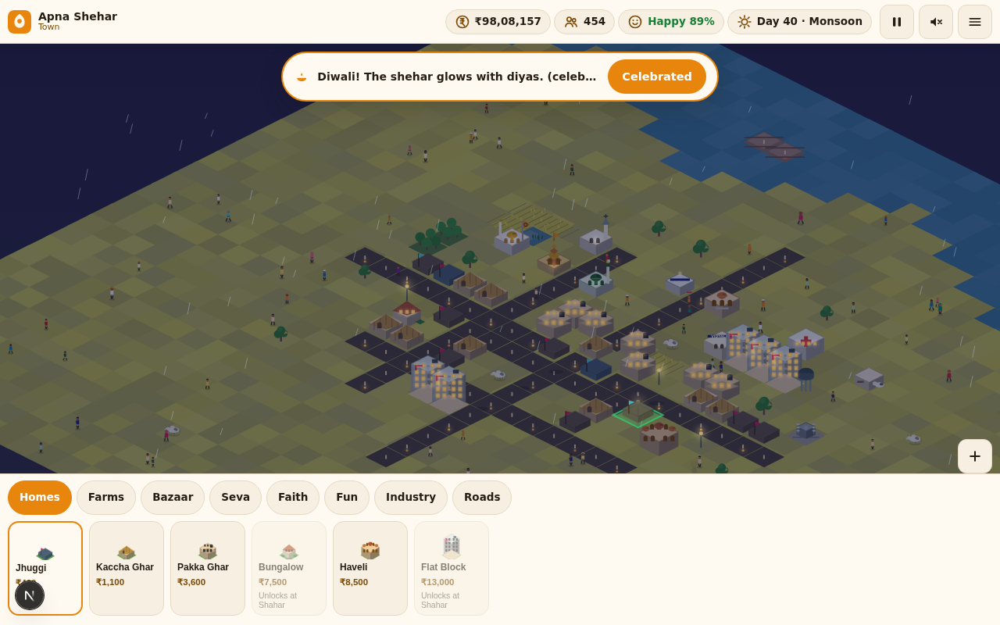
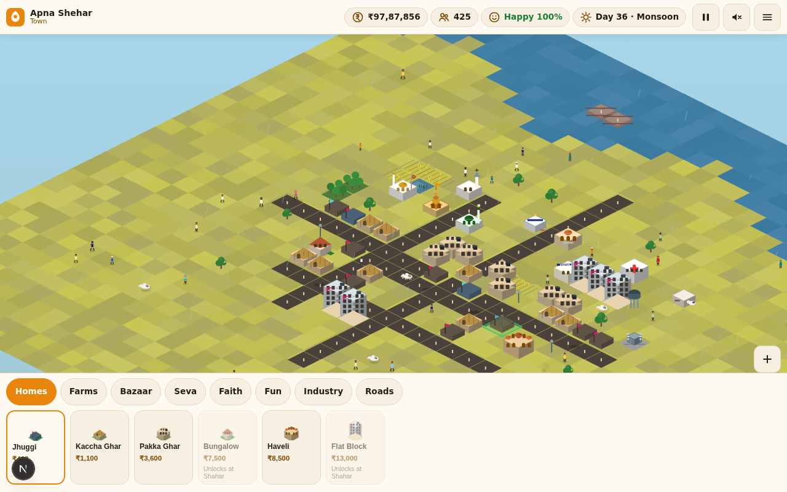

# Apna Shehar — India City Builder



**Build your own India — from chhota gaon to mahanagar.** A free, zero-dependency
browser city-builder: place mandirs, dhabas and chai tapris, watch people in
sarees and kurtas walk your gullies, dodge the sacred cow stuck on the main
road, and celebrate Diwali under fireworks.

**Play: [superz1402.github.io/india-city-builder](https://superz1402.github.io/india-city-builder/)**



## What's inside

- **Isometric 2.5D world** — fully procedural canvas art, no image assets.
  35+ Indian building types: jhuggis to flat blocks, kirana shops to textile
  mills, mandir / masjid / gurudwara / church, mela ground with an animated
  ferris wheel, HORN OK PLEASE trucks.
- **Deep sim** — ₹ treasury, taxes scaled by khush-hali, jobs, food, water and
  power with load-shedding, pollution vs parks, population that arrives (or
  leaves) on merit. Five tiers: Chhota Gaon → Kasba → Town → Shahar → Mahanagar.
- **Living streets** — people in sarees, salwar kameez, kurtas, dhotis, lungis
  and turbans; autos, buses, cycles, bullock carts; sacred cows with right of
  way (and the occasional traffic jam they cause).
- **Festivals & seasons** — Diwali (diyas + fireworks), Eid (lanterns), Holi
  (colour), Republic Day (tricolor parade), Baisakhi (harvest bonus). Summer
  heat, monsoon rain that doubles paddy, winter fog.
- **Day–night cycle** — windows light up, street lamps glow, cinema marquee
  blinks, all rendered as a light pass over the world.
- **Desi audio** — a synthesized tabla loop + tanpura drone + SFX via WebAudio.
  No audio files, off by default, one tap to enable.
- **Autosave** — versioned localStorage save every 10 s and on tab hide.

## Controls

| Action | Desktop | Mobile |
| --- | --- | --- |
| Pan | drag | drag |
| Zoom | scroll / +− buttons | pinch / +− buttons |
| Build | click card → click map | tap card → tap map |
| Inspect / remove | click placed building | tap placed building |
| Pause / speed | Space or the HUD button | HUD button |

## Run it yourself

```bash
# it's a static site — any server works
python3 -m http.server 8080
# open http://localhost:8080
```

No build step, no dependencies, no API keys. Deploy = push to `main`
(GitHub Pages serves the repo root). `health.yml` syntax-checks every module
and guards against committed secrets on every push.

## Architecture

```
index.html            shell + HUD skeleton + inline SVG icon set
css/style.css         tokens-first design system (light/dark chrome)
js/data.js            building defs, economy constants, festivals, tiers
js/state.js           game state, terrain gen, placement rules, aggregates
js/iso.js             isometric projection, camera, pointer/pinch input
js/render.js          frame compositor: terrain, depth sort, night, weather
js/arts.js            the procedural art kit (buildings, people, vehicles, cows)
js/sim.js             daily economy tick, happiness, growth, seasons, events
js/agents.js          people / vehicle / cow random-walk agents
js/events.js          festival lifecycle + celebration
js/ui.js              HUD, build menu, panels, notices (DOM layer)
js/audio.js           WebAudio tabla loop, drone, SFX
js/save.js            versioned localStorage save/load
js/main.js            boot, loop, autosave, error surface
```

## Credits & standards

- Inspired by [buildacountry](https://buildacountry.github.io/) — this is an
  original, more extensive Indian-style take (different engine, art and code).
- UI built to the rules of [agent-ui-playbook](https://github.com/superz1402/agent-ui-playbook):
  token-first styling, no emoji icons, tabular numerals, 44 px touch targets,
  honest empty/error states, screenshot-verified changes.
- Agent workflow (issues → build → close, worklog, session persistence) lives
  in [AGENTS.md](AGENTS.md).

## License

MIT — see [LICENSE](LICENSE).
