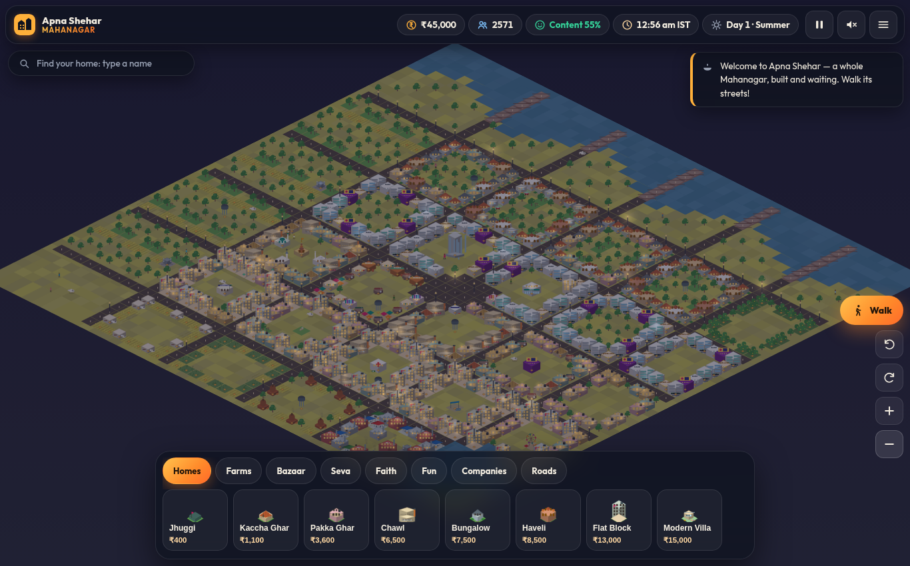
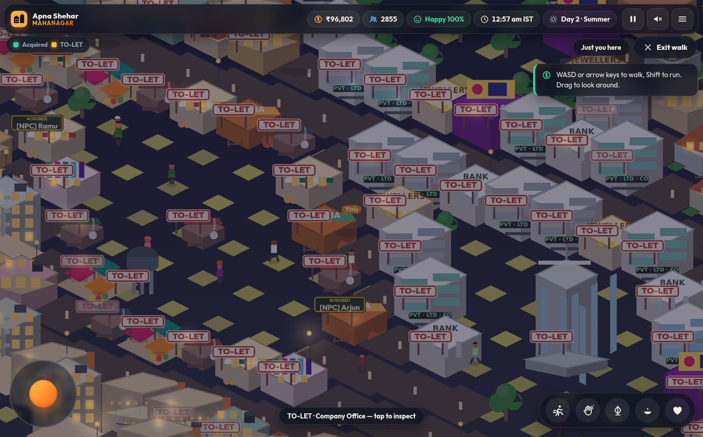

# Apna Shehar — India City Builder



**A whole Indian city, built and waiting — then walk its streets, in real Indian time.** A free,
zero-dependency browser city-builder that boots into a **pre-built Mahanagar**: Civil Lines
bungalows and villas, a CBD of company offices, a corporate tower, mall and hotel, the Old
Mohalla bazaar, chawls, a residential colony, factories and farms — all laced together with
avenues, a river with bridges, street lamps and traffic. Every home and shop shows its deed at
the **door**: green plates are **ACQUIRED**, cream boards are **TO-LET**. Deed them to residents
(they own them like a metaverse), watch people in sarees and kurtas walk your gullies, dodge the
sacred cow stuck at the chowk, and celebrate Diwali under fireworks — all on the **actual Indian
Standard Time clock**.

**Play: [superz1402.github.io/india-city-builder](https://superz1402.github.io/india-city-builder/)**



## What's inside

- **A whole pre-built city (v3 Mahanagar)** — the 48×48 map boots with 1,300+ placed tiles:
  five avenues with a central chowk, bridges over the river, and five districts (Civil Lines,
  CBD, Old Mohalla & Bazaar, Colony, Industrial edge). Extend it from the build dock.
- **Door plates (v3)** — walk the streets and read ownership at the doors: green ACQUIRED
  nameplates carry the owner's name; cream TO-LET boards mark what's still available. The map
  view shows green/amber doorstep dots; tap any door for its deed card.
- **Walk mode (v2)** — be a visitor in your own city. Third-person avatar with
  WASD/arrows or an on-screen joystick, Shift/RUN to jog, drag to look around,
  gamepad support, emotes (wave, namaste, diya, heart) with name tags. "You + N
  nearby", just like the reference.
- **Real IST day–night (v2)** — the sky, lamps and citizen schedules follow the
  actual clock in India (UTC+5:30). 8 pm IST looks like 8 pm IST.
- **Metaverse ownership (v2)** — every home and shop can have a deed. Assign
  owners in game (tap building → Assign owner) or in code (`js/owners.js`).
  Residents live by their deeds: home at night, shop by day, evening strolls.
  Search any name to find their home.
- **Isometric 2.5D world** — fully procedural canvas art, no image assets.
  40+ Indian building types: jhuggis to chawls, villas and flat blocks, kirana shops to a mall,
  company offices to a glass corporate tower, hotel, petrol pump, textile mills,
  mandir / masjid / gurudwara / church, mela ground with an animated
  ferris wheel, HORN OK PLEASE trucks.
- **Deep sim** — ₹ treasury, taxes scaled by khush-hali, jobs, food, water and
  power with load-shedding, pollution vs parks, population that arrives (or
  leaves) on merit. Five tiers: Chhota Gaon → Kasba → Town → Shahar → Mahanagar.
- **Living streets** — people in sarees, salwar kameez, kurtas, dhotis, lungis
  and turbans; hatchbacks, kaali-peeli taxis, autos, buses, cycles, bullock carts; sacred cows
  with right of way (and the occasional traffic jam they cause).
- **Festivals & seasons** — Diwali (diyas + fireworks), Eid (lanterns), Holi
  (colour), Republic Day (tricolor parade), Baisakhi (harvest bonus). Summer
  heat, monsoon rain that doubles paddy, winter fog.
- **Desi audio** — a synthesized tabla loop + tanpura drone + SFX via WebAudio.
  No audio files, off by default, one tap to enable.
- **Autosave** — versioned localStorage save every 10 s and on tab hide.

## Controls

| Action | Desktop | Mobile |
| --- | --- | --- |
| Pan the map | drag | drag |
| Rotate / look | rotate buttons; in walk: drag | same |
| Zoom | scroll / +− buttons | pinch / +− buttons |
| Build | click card → click map | tap card → tap map |
| Inspect / owner / remove | click placed building | tap placed building |
| **Walk** | Walk button → WASD/arrows, Shift run, drag look, 1-4 emotes | Walk button → joystick, RUN, emote buttons |
| Visit a resident | search name or People & homes panel | same |
| Pause / speed | Space or the HUD button | HUD button |

## Own the code: buildings & residents (for the city owner)

Everything is code-side. Two files to edit:

**1. Add or change a building — `js/data.js`**

```js
// add one line to BUILDINGS, then one draw case in js/arts.js
library: { name: 'Public Library', cat: 'civic', cost: 8000, upkeep: 10,
           jobs: 4, happy: 6, cover: 6, pw: -1, tier: 2, draw: 'library',
           desc: 'Silence, fans, and every Tintin.' },
```
The build menu, thumbnails, economy and unlock tiers pick it up automatically.

**2. Add a resident / give them a home or shop — `js/owners.js`**

The city keeps fake humans deliberately tiny — **four [NPC]-tagged residents**
(owner rule: "don't add fake humans, 4 is enough, bracket-name them npc").

```js
export const RESIDENTS = ['[NPC] Ramu', '[NPC] Meera' /* keep the [NPC] tag */];
export const ASSIGNMENTS = [
  { name: '[NPC] Ramu', home: '17,18', shop: '20,14' },  // tiles as "x,y"
];
```

- Deeds attach to map tiles; the building on the tile can be rebuilt freely.
- Residents appear in search, the People & homes panel, and physically walk
  near their properties with name tags, on the real IST clock.
- In-game assignments (tap building → Assign owner) persist in the browser;
  this code file always wins for the same name.

**3. Parametric knobs — pin a look per tile (adapted from
[lucas-martinic/polyfork-catalog](https://github.com/lucas-martinic/polyfork-catalog))**

Knobbed buildings (21 of them — tarp, wall, roof, paint, stone, awning,
canopy, silks, shikhara, dome, wash, porch, glass, crown, signage, board)
resolve their look deterministically from the
plot seed, so streets show stable per-plot variety. Option 0 of every knob
is the original look. To pin one code-side:

```js
place(18, 18, 'pakka', { knobs: { paint: 'teal' } });
```

The registry lives in `KNOBS` (`js/data.js`); pins persist in save v2.
In-game, plan mode shows the same knobs as chip rows ("Looks") in the tile
card — tap to pin, tap the pinned chip again to return to the seeded look.
Full knob list per building: see `catalog.json` (assets[].knobs) or
`llms.txt`.

**4. Content catalog — `catalog.json`** (schema adapted from
[lucas-martinic/polyfork-catalog](https://github.com/lucas-martinic/polyfork-catalog)):
after editing the registries, run `node scripts/catalog.mjs` to regenerate the
machine-readable index of every asset (v3: polyfork-aligned
`kits[]`/`assets[]` schema with per-asset knobs), resident, deed, festival
and tier. Tools, spreadsheets and future agents read the city from one JSON
file — `llms.txt` is the agent-facing API doc.

## Run it yourself

```bash
# it's a static site — any server works
python3 -m http.server 8080
# open http://localhost:8080
```

No build step, no dependencies, no API keys. Deploy = push to `main`
(GitHub Pages serves the repo root). `health.yml` syntax-checks every module
and guards against committed secrets on every push.

## Architecture

```
index.html            shell + HUD skeleton + inline SVG icon set
css/style.css         tokens-first design system (light/dark chrome)
js/data.js            building defs, economy constants, festivals, tiers
js/state.js           game state, terrain gen, placement rules, walkability
js/clock.js           REAL Indian Standard Time (UTC+5:30) — sky & schedules
js/owners.js          the deed book: residents + who owns which home/shop
js/walk.js            walk mode: avatar, joystick/keys/gamepad, resident AI
js/iso.js             isometric projection, orbit camera, pointer/pinch input
js/render.js          frame compositor: terrain, depth sort, night, weather
js/arts.js            the procedural art kit (buildings, people, vehicles, cows)
js/sim.js             daily economy tick, happiness, growth, seasons, events
js/agents.js          people / vehicle / cow random-walk agents
js/events.js          festival lifecycle + celebration
js/ui.js              HUD, build menu, panels, search, deed UI (DOM layer)
js/audio.js           WebAudio tabla loop, drone, SFX
js/save.js            versioned localStorage save/load
js/main.js            boot, loop, autosave, error surface
```

## Credits & standards

- Inspired by [buildacountry](https://buildacountry.github.io/) — this is an
  original, more extensive Indian-style take (different engine, art and code).
- UI built to the rules of [agent-ui-playbook](https://github.com/superz1402/agent-ui-playbook):
  token-first styling, no emoji icons, tabular numerals, 44 px touch targets,
  honest empty/error states, screenshot-verified changes.
- Agent workflow (issues → build → close, worklog, session persistence) lives
  in [AGENTS.md](AGENTS.md).

## License

MIT — see [LICENSE](LICENSE).
